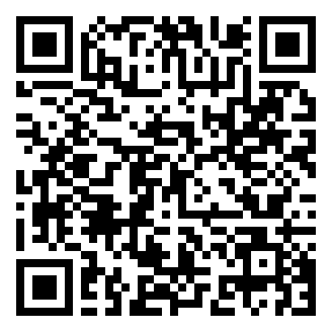

## Title of the Talk

Subtitle of the talk

useblocks User Day 2026 in Munich <!-- .element: class="talk-event" -->

Note:

Welcome the audience. Say the title of the talk.

---

### Who are we?

Speaker 1

Speaker 2

Speaker 3

Note:

Each speaker says who they are in one or two sentences.

---

### The Talk Starts Here

Replace this slide with the content of the talk.

---

### Questions?

https://avengineers.github.io/UseblocksUserday2026/docs/_template/ <!-- .element: class="deck-url" -->

---

### Some Links

- [We@GitHub](https://github.com/avengineers)
- [Printable Slides](https://avengineers.github.io/UseblocksUserday2026/docs/_template/?print-pdf)
