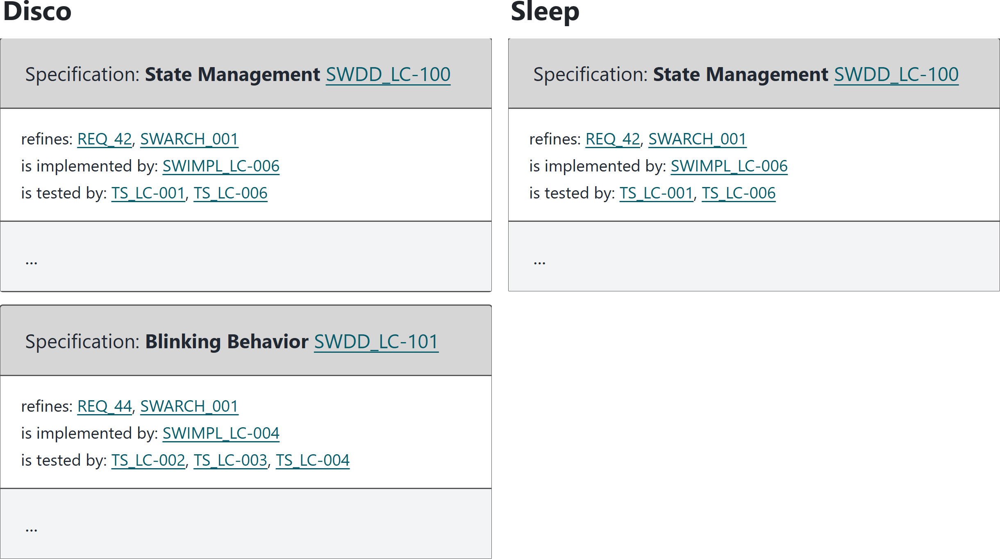

## Advanced Variant Management with Sphinx-Needs

One feature model for the code, the tests and the documentation

<hr>

useblocks User Day 2026 in Munich <!-- .element: class="talk-event" -->

<div class="talk-logos">


</div>

Note:

Welcome the audience. Say the title of the talk.

---

### Who are we?

<div class="speakers">
<div class="speaker">


[Judith](https://www.linkedin.com/in/judith-reichwein-873665258/)

</div>
<div class="speaker">


[Karsten](https://www.linkedin.com/in/karnangue/)

</div>
<div class="speaker">


Philip

</div>
</div>

Note:

Each speaker says who they are in one or two sentences.

---

### Where we left off

<div class="mermaid">
<pre>
flowchart LR
    FM["Feature model&lt;br/&gt;KConfig"] --> B["Build&lt;br/&gt;CMake"]
    FM --> T["Tests&lt;br/&gt;GoogleTest"]
    FM -. "Jinja templates" .-> D["Documentation&lt;br/&gt;Sphinx-Needs"]
</pre>
</div>

- 2024: one feature model drives the build, the IDE and the tests
- 2025: requirement, design, code, test and result, traced with Sphinx-Needs
- Open: is every requirement covered in every variant?

Note:

(Karsten) Two years ago at the CodeDays, we showed how one feature model drives the build,
the IDE and the tests of a product line. Last year, our colleagues Michael and Jochen stood
here and showed the traceability chain from the requirement to the test result, written as
code and resolved by Sphinx-Needs. The documentation followed the variant too, but only
through Jinja templates. One question stayed open in both talks: how do I see that every
requirement is covered in every variant? Today we close that gap.

---

### SPLED in one slide

<div class="mid-table">

| Variant | Features | Components on top of the common eleven |
|---|---|---|
| Disco | blinking | – |
| Sleep | manual brightness, auto off after 10 s | `brightness_controller`, `auto_off` |
| Spa | automatic brightness, every 10 s | `brightness_controller` |

</div>

One repository, one feature model, one `config.txt` and one `parts.cmake` per variant.

Note:

(Karsten) SPLED is our open-source demonstrator: a product line of lights. Disco blinks.
Sleep has a brightness knob and switches itself off. Spa adjusts its brightness on its own.
The `config.txt` of a variant selects the features, and its `parts.cmake` selects the
components. Everything we show today runs on this repository.

---

### One feature model, three artifacts

<div class="mermaid">
<pre>
flowchart LR
    K["KConfig&lt;br/&gt;config.txt"] --> C["CMake configure"]
    P["parts.cmake"] --> C
    K --> V["variant_data.py"]
    P --> V
    C --> H["autoconf.h&lt;br/&gt;code"]
    C --> M["autoconf.cmake&lt;br/&gt;build"]
    V --> J["docs.json&lt;br/&gt;documentation"]
</pre>
</div>

The same selection decides what is compiled, what is tested and what is documented.

Note:

(Karsten) The feature model and the selection of a variant go into the CMake configure step.
Out come a header for the code and a CMake file for the build. That has worked for years. The
new part is the third output: a small generator reads the same files and writes a data file
for the documentation. It needs no compiler, so the documentation knows the variant before
anything is built.

---

### Documents as templates

````markdown


```{spec} Blinking Behavior
:id: SWDD_LC-101
:refines: SWARCH_001, REQ_44
```


````

- A reader that does not run the template sees text, not a variant
- The rendered lines no longer match the lines of the source
- Only a build knows the variant

Note:

(Karsten) This is how the light controller's design looked until recently. The Jinja
condition is resolved before Sphinx parses the page. That works for the HTML report. It does
not work for a tool that reads the source as it is, such as an editor or a language server.
And because the template changes the text, the line numbers of the rendered page no longer
point to the source. For a safety argument, that trace from the evidence back to the source
matters.

---

### Declarative instead

`````markdown
````{if} var.features.BLINKING
```{spec} Blinking Behavior
:id: SWDD_LC-101
:refines: SWARCH_001
```
````
`````

- The condition is part of the document language
- Sphinx and ubCode evaluate the same condition on the same data
- `{variant}` prints a value of the variant into the text

Note:

(Philip) The same specification, without a template. The `{if}` block is a directive of the
document language, so every reader understands it: the Sphinx build, ubCode in the editor
and the ubc command line. The condition reads the features of the selected variant. Nothing
is generated into the text, so the lines stay where they are.

---

### The variant as data

```json
{
  "build_config": {
    "variant": "Sleep",
    "kit": "test",
    "components": [
      "components/light_controller",
      "components/brightness_controller",
      "components/auto_off"
    ]
  },
  "features": {
    "AUTO_OFF": true,
    "AUTO_OFF_PERIOD_SECONDS": 10,
    "BLINKING": false
  }
}
```

`python tools/variant_data.py --variant Sleep --kit test --current`

Note:

(Philip) This is the data file of Sleep, shortened. The generator writes one such file per
variant and kit, without a compiler. It holds every feature, the ones that are off too, and
the list of components from `parts.cmake`. One small file names the current selection, and
every reader follows it.

---

### Whole components in or out

```toml
# components/auto_off (generated, shortened)
[[source.variant_sources]]
if = "'components/auto_off' in var.build_config.components"
files = ["components/auto_off/**"]
```

- One rule per component, generated from `parts.cmake`
- sphinx-mounts and ubCode read the same rule
- A component that is left out has no page and no needs

Note:

(Philip) A whole component either belongs to a variant or not. The generator writes one rule
per component into `ubproject.variants.toml`. The Sphinx build reads it through
sphinx-mounts, and ubCode reads it directly. The rule asks for the component, never for the
name of the variant. So a new variant needs no change in any document.

---

### The editor knows the variant

 <!-- .element: style="max-height: 420px;" -->

In ubCode, the inactive blocks fade, and a left-out document shows as
`toctree.variant_excluded`.

Note:

(Philip) On the left the report of Disco, on the right the report of Sleep. Sleep has no
blinking, so the blinking specification is not there. In ubCode you see the same in the
editor, while you write: select a variant, and the blocks that do not apply fade.

---

### What if?

```text
> ubc diff -c "needs.variant_data.features.BLINKING = false"
Found 91 need(s).
...
Found 89 need(s).
NEEDS DIFF
----------
Removed need SWDD_LC-101
Removed need SWDD_LC-203
```

One changed value, no build, and the answer in seconds.

Note:

(Philip) With Disco selected, we switch off one feature on the command line. ubc builds the
needs twice and prints the difference. Two needs go away: the blinking behavior, and the
main knob input that sets the blinking rate. No file was changed, and nothing was compiled.

---

### Code and tests trace per variant

```c
#ifdef CONFIG_BRIGHTNESS_ADJUSTMENT_AUTOMATIC
    // @need Automatic brightness adjustment in the runnable,
    //   SWIMPL_BC-004c, impl, [SWDD_BC-203], [REQ_48]
```

```cpp
#if CONFIG_BLINKING
/** @rst
 * .. test:: light_controller.test_light_blinking
 *    :id: TS_LC-002
 *    :tests: SWDD_LC-101
 * @endrst */
```

Note:

(Judith) The implementation traces to the design with one comment line. codelinks reads the
compile database of the build, so this need exists only in the variant that compiles this
branch: Spa. The test specification sits above the test, under the same condition as the
test itself. In Sleep and Spa, neither the test nor its specification exists. The comment
in the source is one line; it is wrapped here only to fit the slide.

---

### Test results are needs

```cmake
set(SPL_TEST_RESULTS_AS_NEEDS ON)
```

- GoogleTest writes JUnit XML, and the build turns each test case into a need
- Each test specification links to its results
- `cmake --build build/Disco/test/Debug --target components_light_controller_report`

Note:

(Judith) One switch in the CMake file, and the results of the unit tests become needs. Each
test specification links to its results. The developer builds the report of one
component on their own machine, before they push. That is shift-left: the evidence exists
before the review starts.

---

### Covered in every variant?


Sleep does not select blinking, so REQ_44 has no entries, by design.

Next: a schema rule such as "every implementation has a test", in the editor and in CI.

Note:

(Judith) This is the traceability matrix of the Sleep report. The requirement for blinking
has no design and no implementation in Sleep, and that is correct. In Disco, the same row is
full. The matrix comes out of the build for each variant. This figure was built from the
upstream SPLED repository; the useblocks fork gets the matrix when it merges upstream.
The next step is to make the rule
explicit: a schema that says every implementation has a test. ubCode then marks each gap
while you write, and CI refuses a change that opens one.

---

### Two readers, one answer

```text
for each variant, kit and target:
    sphinx-build -W   ->  needs.json
    ubc build html    ->  needs.json
    compare them, need by need
```

- The allowed differences are listed in one file, `test/docs_exceptions.toml`
- The CI job reports the build time of both readers per cell

Note:

(Judith) Two readers of the same documents must give the same answer. CI builds every
variant, every kit and every target twice: once with Sphinx, once with ubc. Then it compares
the needs one by one. Every allowed difference is written down in one file. If a reader
disagrees anywhere else, the change does not merge.

---

### Adopt it, and what's next

<div class="flex-container">
<div class="half">

**Mandatory**

- `ubproject.toml` with the needs model
- No Jinja: variant data, `{if}`, generated rules
- spl-core with the new opt-in settings

</div>
<div class="half">

**Next**

- Upstream into spl-core and SPLED
- Select the variant through CMake Tools
- Variation points inside diagrams
- A schema rule as a gate

</div>
</div>

Note:

(Karsten) Three changes are mandatory. A project describes its needs model in
`ubproject.toml`, because ubCode does not run `conf.py`. The documents drop Jinja for the
`{if}` directive. And spl-core gets the new opt-in settings; that pull request is open. The
conversion of the documents is mechanical. What comes next: the changes go upstream, the
developer selects the variant where they already do it in VS Code, diagrams get their own
variation points, and the schema rule becomes a gate.

---

### Try it

```bash
git clone https://github.com/useblocks/SPLed
cd SPLed
python tools/try_variants.py all
```

The guide `VARIANTS.md` walks through 19 use cases.

Note:

(Karsten) Everything we showed is open source. The guided tour sets up the environment,
builds the documents of one variant, builds a component report, and compares two variants.
The guide in the repository explains each use case step by step.

---

### Questions?

<div class="qr">


</div>

https://avengineers.github.io/UseblocksUserday2026/docs/variant_management/ <!-- .element: class="deck-url" -->

---

### Some Links

- [We@GitHub](https://github.com/avengineers)
- [SPLED, the demo of this talk](https://github.com/useblocks/SPLed)
- [Printable Slides](https://avengineers.github.io/UseblocksUserday2026/docs/variant_management/?print-pdf)
