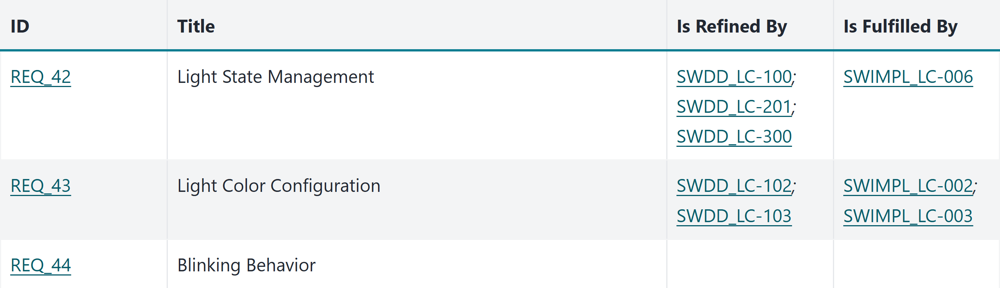

## Advanced Variant Management with Sphinx-Needs

The variant in the IDE, not only in the report

<hr>

useblocks User Day 2026 in Munich <!-- .element: class="talk-event" -->

<div class="talk-logos">


</div>

Note:

Welcome the audience. Say the title of the talk.

---

### Who are we?

<div class="speakers">
<div class="speaker">


[Judith](https://www.linkedin.com/in/judith-reichwein-873665258/)

</div>
<div class="speaker">


[Karsten](https://www.linkedin.com/in/karnangue/)

</div>
<div class="speaker">


Philip

</div>
</div>

Note:

Each speaker says who they are in one or two sentences.

---

### Agenda

<div class="mid-table">

| Chapter | Speaker |
|---|---|
| SPLED and engineering as code | Karsten |
| Variants and traceability | Judith |
| The same in ubCode | Philip |
| Why we want it, and how to adopt it | Karsten |

</div>

Note:

(Karsten) Four parts. I start with where we left off: SPLED, its feature model and our idea
of engineering as code. Judith shows how the variant lives in our documents, and how we
trace per variant. Philip shows what changes to see all of this in ubCode. I close with why
we want it, and what it takes to adopt it.

---

### Where we left off

<div class="mermaid">
<pre>
flowchart TB
    FM["Feature model&lt;br/&gt;KConfig"] --> B["Build system&lt;br/&gt;CMake and the IDE"]
    FM --> S["Source code&lt;br/&gt;production and test"]
    FM --> D["Documentation&lt;br/&gt;Sphinx-Needs"]
</pre>
</div>

- Since 2023: one feature model for build, code, tests and documentation <!-- .element: class="fragment" -->
- Traceability per variant, in the generated report <!-- .element: class="fragment" -->

Note:

(Karsten) Since 2023, one feature model configures our product line. The build system reads
it, and through the build system the IDE. The production code and the test code read it. And
the documentation reads it, down to the single Sphinx-Needs object: a requirement, a design
element or a test exists only in the variants that select it. We showed this at the CodeDays
2024, and Michael and Jochen showed it here last year, with the traceability from the
requirement to the test result. The report of every variant shows that traceability.

--

### SPLED: Software Product Line Engineering Demonstrator

<div class="lights">
<div class="fragment">


Sleep <!-- .element: class="caption" -->

</div>
<div class="fragment">


Disco <!-- .element: class="caption" -->

</div>
<div class="fragment">


Spa <!-- .element: class="caption" -->

</div>
</div>

One repository, one trunk, three products <!-- .element: class="fragment" -->

Note:

(Karsten) SPLED is our Software Product Line Engineering Demonstrator, and it is open source: a
product line of lights. The Sleeping Light, the Disco Light and the Spa Light. One repository,
one trunk, three products. Nobody forked anything to get the third one.

SPLED is more than a demo of how this works. It shows how our software developers work every
day. And it is the basis for the development of our SPLE Platform: every new feature of the
platform is tested in SPLED first. Everything we show today runs on this repository.

--

### Four features, three products

<div class="mid-table">

| Feature | Sleep | Disco | Spa |
|---|---|---|---|
| Blinking | – | yes | – |
| Brightness adjustment | manual | not available | automatic, every 10 s |
| Switch off after a while | after 10 s | – | – |
| Colour | purple | green | purple and green |
| Extra components | `brightness_controller`, `auto_off` | – | `brightness_controller` |

</div>

No branches: the `config.txt` of a variant selects the features. <!-- .element: class="fragment" -->

Note:

(Karsten) Four features separate the three products. Everything else is shared, built once and
tested once. One cell is interesting: the Disco Light has no brightness adjustment, and that is
not missing work. The feature model forbids it. Brightness adjustment depends on blinking being
off, and the tool refuses the combination when you configure the variant. The last row is what
the build system makes of the features: Sleep and Spa get components on top of the common
eleven. Philip comes back
to that row.

--

### Engineering as Code

<div class="mermaid">
<pre>
flowchart LR
    R["One repository&lt;br/&gt;requirements, design,&lt;br/&gt;code and tests"] --> B["Build of&lt;br/&gt;one variant"]
    FM["Feature model"] --> B
    B --> P["Report of the variant&lt;br/&gt;with its traceability"]
</pre>
</div>

- Requirements, design and tests as text, next to the code <!-- .element: class="fragment" -->
- Each artifact names what it refines, implements or tests <!-- .element: class="fragment" -->
- The build resolves the links, one variant at a time <!-- .element: class="fragment" -->

Note:

(Karsten) Engineering as code means that our engineering artifacts live where the code lives.
The requirements, the architecture, the design and the tests are text files in one
repository. Each artifact has an ID and names what it depends on: a design element names the
requirement it refines, an implementation names the design element it implements, and a test
names the design element it tests. So a link is data that a tool can read, not a sentence
that somebody has to notice. The build reads these links for one variant at a time and writes
the report of that variant. Nobody assembles this report by hand.

---

### One feature, every layer

<div class="mid-table">

| Layer | Condition | Need |
|---|---|---|
| Feature model | `config BLINKING` | – |
| Variant Disco | `CONFIG_BLINKING=y` | – |
| Design | `` | SWDD_LC-101 |
| Code | `#ifdef CONFIG_BLINKING` | SWIMPL_LC-004 |
| Test | `#if CONFIG_BLINKING` | TS_LC-002 |

</div>

- Same name in every layer <!-- .element: class="fragment" -->
- Set once, in the `config.txt` of the variant <!-- .element: class="fragment" -->

Note:

(Judith) Let us follow one feature through all layers: blinking. The feature model in
`KConfig` declares it. The `config.txt` of Disco selects it; Sleep and Spa do not. The design
of the light controller, in `components/light_controller/doc/index.md`, puts the blinking
behavior SWDD_LC-101 under the same condition. So does the production code in
`light_controller.c` with the implementation SWIMPL_LC-004, and the test code in
`test_light_controller.cc` with the test specification TS_LC-002. It is the same name in every
layer, and the variant sets it in one place.

--

### Links in code and tests

<div class="wide-code">
<div class="fragment">

<p class="caption">Production code: <code>components/light_controller/src/light_controller.c</code></p>

```c
#ifdef CONFIG_BLINKING
/**
 * @rst
 * .. impl:: Calculate blink period
 *    :id: SWIMPL_LC-004
 *    :implements: SWDD_LC-101
 *    :fulfills: REQ_44
 * @endrst
 */
SPLE_TESTABLE_STATIC percentage_t calculateBlinkPeriod(percentage_t mainKnobValue)
{ ... }
#endif
```

</div>
<div class="fragment">

<p class="caption">Test code: <code>components/light_controller/test/test_light_controller.cc</code></p>

```cpp
#if CONFIG_BLINKING
/**
 * @rst
 * .. test:: light_controller.test_light_blinking
 *    :id: TS_LC-002
 *    :tests: SWDD_LC-101
 * @endrst
 */
TEST(light_controller, test_light_blinking)
{ ... }
// ... two more blinking tests
#endif // CONFIG_BLINKING
```

</div>
</div>

Note:

(Judith) This is how the links look in the code. Above the function, a comment block names
the implementation SWIMPL_LC-004, the design element it implements and the requirement it
fulfills. Above the test, the test specification TS_LC-002 names the design element it tests.
Both sit inside the blinking condition. clanguru reads the sources with the compile database
of the variant, so these needs exist only in the variant that compiles this branch: Disco. The
result of the test is linked to its specification by the name of the test case. Both listings
come from our SPLED repository. The function body and two more blinking tests are left out
here.

--

### Two variants, two reports

<div class="figure">


</div>

- Not selected: not in the report <!-- .element: class="fragment" -->
- Nothing marked "not applicable" by hand <!-- .element: class="fragment" -->

Note:

(Judith) This is the design of the light controller, once in the report of Disco and once in
the report of Sleep. Both show the state management, with the same links. Only Disco shows the
blinking behavior, with its implementation and its three tests. In Sleep, the blinking
behavior does not exist. Nobody deleted it, and nobody marked it as not applicable. The report
of Sleep does not contain what Sleep does not have.

--

### What it gives us

- One source, no document per variant <!-- .element: class="fragment" -->
- One feature name, from the feature model to the test <!-- .element: class="fragment" -->
- Evidence from the build, before the push <!-- .element: class="fragment" -->
- Requirement, design and test in one pull request <!-- .element: class="fragment" -->

Note:

(Judith) What does this give us? We write each document once, for all variants, and still get
a correct report for each variant. The feature has one name, from the feature model to the
test, so the documents and the code cannot drift apart. The evidence comes out of the build. A
developer builds the report of a variant on their own machine, before they push. And when a
requirement changes, the reviewer sees in the same pull request whether the design and the
tests changed with it.

--

### The matrix of Sleep

<div class="figure">



</div>

- Made by the build, for each variant <!-- .element: class="fragment" -->
- REQ_44 empty: Sleep does not blink <!-- .element: class="fragment" -->

Note:

(Judith) Every variant report has a traceability matrix. For each requirement, it shows the
design elements that refine it and the implementations that fulfill it. This is the matrix of
Sleep, shortened. REQ_44 is the blinking behavior, and its row is empty. That is correct,
because Sleep does not select blinking. Today the reader has to know this. The imported
requirement already carries the name of its feature, but the matrix does not use it yet.

---

### Documents as templates

<div class="wide-code">
<div class="fragment">

<p class="caption">Detailed design: <code>components/light_controller/doc/index.md</code></p>

````markdown


```{spec} Blinking Behavior
:id: SWDD_LC-101
:refines: SWARCH_001, REQ_44

When the light is ON, it may exhibit a blinking behavior.
The blinking rate is configurable and is determined based
on an external input (main knob value).
```


````

</div>
</div>

- The IDE shows only text, no variant. <!-- .element: class="fragment" -->
- Variant known only to the build <!-- .element: class="fragment" -->

Note:

(Philip) This is the design that Judith just showed, as our SPLED repository has it today.
The Jinja condition is resolved before Sphinx parses the page. That works for the HTML report.
It does not work for a tool that reads the source as it is, such as an IDE or a language
server. While you write, the IDE sees a template, not a variant.

--

### Declarative instead

`````markdown
````{if} var.features.BLINKING
```{spec} Blinking Behavior
:id: SWDD_LC-101
:refines: SWARCH_001
```
````
`````

- The variant as part of the document language <!-- .element: class="fragment" -->
- Same condition, same data, in Sphinx and ubCode <!-- .element: class="fragment" -->
- `{variant}`: a value of the variant in the text <!-- .element: class="fragment" -->

Note:

(Philip) The same specification, without a template. The `{if}` block is a directive of the
document language, so every reader understands it: the Sphinx build, ubCode in the IDE
and the ubc command line. The condition reads the features of the selected variant. Nothing
is generated into the text, so the lines stay where they are.

--

### The variant as data

```json
{
  "build_config": {
    "variant": "Sleep",
    "kit": "test",
    "components": [
      "components/light_controller",
      "components/brightness_controller",
      "components/auto_off"
    ]
  },
  "features": {
    "AUTO_OFF": true,
    "AUTO_OFF_PERIOD_SECONDS": 10,
    "BLINKING": false
  }
}
```

`python tools/variant_data.py --variant Sleep --kit test --current`

Note:

(Philip) This is the data file of Sleep, shortened. The generator writes one such file per
variant and kit, without a compiler. It holds every feature, the ones that are off too, and
the list of components from `parts.cmake`. One small file names the current selection, and
every reader follows it.

--

### Whole components in or out

```toml
# components/auto_off (generated, shortened)
[[source.variant_sources]]
if = "'components/auto_off' in var.build_config.components"
files = ["components/auto_off/**"]
```

- One rule per component, generated from `parts.cmake` <!-- .element: class="fragment" -->
- Read by sphinx-mounts and by ubCode <!-- .element: class="fragment" -->
- Component left out: no report, no needs <!-- .element: class="fragment" -->

Note:

(Philip) A whole component either belongs to a variant or not. The generator writes one rule
per component into `ubproject.variants.toml`. The Sphinx build reads it through
sphinx-mounts, and ubCode reads it directly. The rule asks for the component, never for the
name of the variant. So a new variant needs no change in any document.

--

### The IDE knows the variant

<div class="flex-container">
<div class="half">


Disco <!-- .element: class="caption" -->

</div>
<div class="half">


Sleep <!-- .element: class="caption" -->

</div>
</div>

- Inactive `{if}` blocks faded, like a false `#if` <!-- .element: class="fragment" -->
- Folded in the preview, with their condition <!-- .element: class="fragment" -->
- Left-out document: information, not an error <!-- .element: class="fragment" -->

Note:

(Philip) The same design document in ubCode, once with Disco selected and once with Sleep.
You select the variant with a VS Code task. ubCode fades the blocks whose condition is false,
the way the IDE fades C code under a false `#if`. The preview shows them folded, labelled
with their condition, and the needs inside them are not in the index, exactly as in the
Sphinx build. A document of a component that the variant does not have is reported as
information, with the rule that removed it. You see all of this while you write, before any
build.

--

### What if?

```text
> ubc diff -c "needs.variant_data.features.BLINKING = false"
Found 91 need(s).
...
Found 89 need(s).
NEEDS DIFF
----------
Removed need SWDD_LC-101
Removed need SWDD_LC-203
```

One changed value, no build, the answer in seconds

Note:

(Philip) With Disco selected, we switch off one feature on the command line. ubc builds the
needs twice and prints the difference. Two needs go away: the blinking behavior, and the
main knob input that sets the blinking rate. No file was changed, and nothing was compiled.

--

### Two readers, one answer

```text
for each variant, kit and target:
    sphinx-build -W   ->  needs.json
    ubc build html    ->  needs.json
    compare them, need by need
```

- Allowed differences in one file: `test/docs_exceptions.toml` <!-- .element: class="fragment" -->
- Build time of both readers, per cell, in the CI job <!-- .element: class="fragment" -->

Note:

(Philip) Two readers of the same documents must give the same answer. CI builds every
variant, every kit and every target twice: once with Sphinx, once with ubc. Then it compares
the needs one by one. Every allowed difference is written down in one file. If a reader
disagrees anywhere else, the change does not merge.

---

### Why we want it

- Today: no traces in the IDE, only in the Sphinx report <!-- .element: class="fragment" -->
- Every check needs a build <!-- .element: class="fragment" -->
- Errors easily overlooked <!-- .element: class="fragment" -->
- Expected gain: correctness, maintainability, usability <!-- .element: class="fragment" -->

Note:

(Karsten) Why do we want the useblocks tooling? Today, a developer sees the traces only in a
report. Sphinx builds the component report or the variant report, and the IDE shows nothing of
it. So the developer has to run the build to check the traces, and then read an HTML report.
In a report of many pages, a missing or a wrong link is easy to overlook. With ubCode, the
traces of the selected variant are visible in the IDE while the developer writes, and an error
shows where it is made. ubc builds the report from the same files. We expect the useblocks
tooling to raise the quality of what we deliver: its correctness, its maintainability, and its
usability for the developer.

--

### Adopt it, and what's next

<div class="flex-container">
<div class="half">

**Mandatory**

- `ubproject.toml` with the needs model <!-- .element: class="fragment" -->
- No Jinja: variant data, `{if}`, generated rules <!-- .element: class="fragment" -->
- spl-core with the new opt-in settings <!-- .element: class="fragment" -->

</div>
<div class="half">

**Next**

- Upstream into spl-core and SPLED <!-- .element: class="fragment" -->
- Select the variant through CMake Tools <!-- .element: class="fragment" -->
- Variation points inside diagrams <!-- .element: class="fragment" -->
- A schema rule as a gate <!-- .element: class="fragment" -->

</div>
</div>

Note:

(Karsten) Three changes are mandatory. A project describes its needs model in
`ubproject.toml`, because ubCode does not run `conf.py`. The documents drop Jinja for the
`{if}` directive. And spl-core gets the new opt-in settings; that pull request is open. The
conversion of the documents is mechanical. What comes next: the changes go upstream, the
developer selects the variant where they already do it in VS Code, diagrams get their own
variation points, and the schema rule becomes a gate.

--

### Try it

```bash
git clone https://github.com/useblocks/SPLed
cd SPLed
python tools/try_variants.py all
```

`VARIANTS.md`: 19 use cases, step by step

Note:

(Karsten) Everything we showed is open source. The guided tour sets up the environment,
builds the documents of one variant, builds a component report, and compares two variants.
The guide in the repository explains each use case step by step.

---

### Questions?

<div class="qr">


</div>

https://avengineers.github.io/UseblocksUserday2026/ <!-- .element: class="deck-url" -->

---

### Some Links

- [We@GitHub](https://github.com/avengineers)
- [SPLED, our original](https://github.com/avengineers/SPLed)
- [SPLED with ubCode, by useblocks](https://github.com/useblocks/SPLed)
- [Printable Slides](https://avengineers.github.io/UseblocksUserday2026/?print-pdf)
