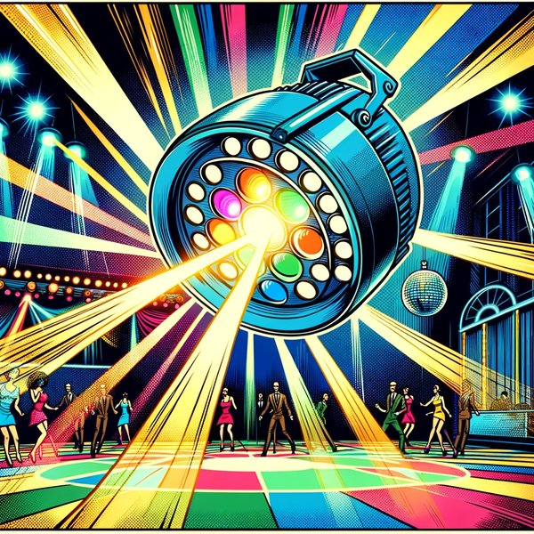
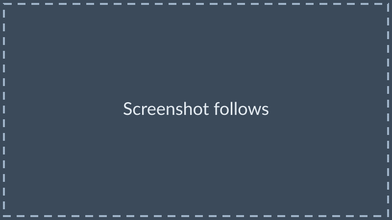

## Advanced Variant Management with Sphinx-Needs

The variant in the editor, not only in the report

<hr>

useblocks User Day 2026 in Munich <!-- .element: class="talk-event" -->

<div class="talk-logos">


</div>

Note:

Welcome the audience. Say the title of the talk.

---

### Who are we?

<div class="speakers">
<div class="speaker">


[Judith](https://www.linkedin.com/in/judith-reichwein-873665258/)

</div>
<div class="speaker">


[Karsten](https://www.linkedin.com/in/karnangue/)

</div>
<div class="speaker">


Philip

</div>
</div>

Note:

Each speaker says who they are in one or two sentences.

---

### Agenda

<div class="mid-table">

| Chapter | Speaker |
|---|---|
| The gap: only the build knows the variant | Karsten |
| Declarative variants | Philip |
| Traceability per variant | Judith |
| Adopt it | Karsten |

</div>

Note:

(Karsten) Four parts. I start with where we left off, and with the gap: only the build knows
the variant.
Philip shows how the documents select their content per variant without templates. Judith
shows what that means for the traceability. I close with what it takes to adopt it.

---

### Where we left off

<div class="mermaid">
<pre>
flowchart TB
    FM["Feature model&lt;br/&gt;KConfig"] --> B["Build system&lt;br/&gt;CMake and the IDE"]
    FM --> S["Source code&lt;br/&gt;production and test"]
    FM --> D["Documentation&lt;br/&gt;Sphinx-Needs"]
</pre>
</div>

- Since 2023, one feature model configures the build, the code, the tests and the documentation <!-- .element: class="fragment" -->
- The report of each variant shows its traceability <!-- .element: class="fragment" -->
- New: the editor knows the variant and supports you while you write <!-- .element: class="fragment" -->

Note:

(Karsten) Since 2023, one feature model configures our product line. The build system reads
it, and through the build system the IDE. The production code and the test code read it. And
the documentation reads it, down to the single Sphinx-Needs object: a requirement, a design
element or a test exists only in the variants that select it. We showed this at the CodeDays
2024, and Michael and Jochen showed it here last year, with the traceability from the
requirement to the test result. The report of every variant shows that traceability. But
you see it only after the build, in the generated report. While you write, the editor sees a
template, not a variant. That is what changes this year: with the useblocks tools, the editor
knows the variant, shows you what belongs to it, and supports you while you write.

--

### SPLED: one code base, three products

<div class="lights">
<div class="fragment">


Sleep <!-- .element: class="caption" -->

</div>
<div class="fragment">



Disco <!-- .element: class="caption" -->

</div>
<div class="fragment">


Spa <!-- .element: class="caption" -->

</div>
</div>

One repository, one trunk, three products. <!-- .element: class="fragment" -->

Note:

(Karsten) SPLED is our open-source demonstrator: a product line of lights. The Sleeping Light,
the Disco Light and the Spa Light. One repository, one trunk, three products. Nobody forked
anything to get the third one. Everything we show today runs on this repository.

--

### Four features, three products

<div class="mid-table">

| Feature | Sleep | Disco | Spa |
|---|---|---|---|
| Blinking | – | yes | – |
| Brightness adjustment | manual | not available | automatic, every 10 s |
| Switch off after a while | after 10 s | – | – |
| Colour | purple | green | purple and green |
| Extra components | `brightness_controller`, `auto_off` | – | `brightness_controller` |

</div>

No branches: the `config.txt` of a variant selects the features. <!-- .element: class="fragment" -->

Note:

(Karsten) Four features separate the three products. Everything else is shared, built once and
tested once. One cell is interesting: the Disco Light has no brightness adjustment, and that is
not missing work. The feature model forbids it. Brightness adjustment depends on blinking being
off, and the tool refuses the combination when you configure the variant. The last row is what
the build system makes of the features: Sleep and Spa get components on top of the common
eleven. Philip comes back
to that row.

--

### Documents as templates

````markdown


```{spec} Blinking Behavior
:id: SWDD_LC-101
:refines: SWARCH_001, REQ_44
```


````

- A reader that does not run the template sees text, not a variant <!-- .element: class="fragment" -->
- The rendered lines no longer match the lines of the source <!-- .element: class="fragment" -->
- Only a build knows the variant <!-- .element: class="fragment" -->

Note:

(Karsten) This is how the light controller's design looked until recently. The Jinja
condition is resolved before Sphinx parses the page. That works for the HTML report. It does
not work for a tool that reads the source as it is, such as an editor or a language server.
And because the template changes the text, the line numbers of the rendered page no longer
point to the source. For a safety argument, that trace from the evidence back to the source
matters.

---

### Declarative instead

`````markdown
````{if} var.features.BLINKING
```{spec} Blinking Behavior
:id: SWDD_LC-101
:refines: SWARCH_001
```
````
`````

- The condition is part of the document language <!-- .element: class="fragment" -->
- Sphinx and ubCode evaluate the same condition on the same data <!-- .element: class="fragment" -->
- `{variant}` prints a value of the variant into the text <!-- .element: class="fragment" -->

Note:

(Philip) The same specification, without a template. The `{if}` block is a directive of the
document language, so every reader understands it: the Sphinx build, ubCode in the editor
and the ubc command line. The condition reads the features of the selected variant. Nothing
is generated into the text, so the lines stay where they are.

--

### The variant as data

```json
{
  "build_config": {
    "variant": "Sleep",
    "kit": "test",
    "components": [
      "components/light_controller",
      "components/brightness_controller",
      "components/auto_off"
    ]
  },
  "features": {
    "AUTO_OFF": true,
    "AUTO_OFF_PERIOD_SECONDS": 10,
    "BLINKING": false
  }
}
```

`python tools/variant_data.py --variant Sleep --kit test --current`

Note:

(Philip) This is the data file of Sleep, shortened. The generator writes one such file per
variant and kit, without a compiler. It holds every feature, the ones that are off too, and
the list of components from `parts.cmake`. One small file names the current selection, and
every reader follows it.

--

### Whole components in or out

```toml
# components/auto_off (generated, shortened)
[[source.variant_sources]]
if = "'components/auto_off' in var.build_config.components"
files = ["components/auto_off/**"]
```

- One rule per component, generated from `parts.cmake` <!-- .element: class="fragment" -->
- sphinx-mounts and ubCode read the same rule <!-- .element: class="fragment" -->
- A component that is left out has no page and no needs <!-- .element: class="fragment" -->

Note:

(Philip) A whole component either belongs to a variant or not. The generator writes one rule
per component into `ubproject.variants.toml`. The Sphinx build reads it through
sphinx-mounts, and ubCode reads it directly. The rule asks for the component, never for the
name of the variant. So a new variant needs no change in any document.

--

### The editor knows the variant

<div class="flex-container">
<div class="half">



Disco <!-- .element: class="caption" -->

</div>
<div class="half">


Sleep <!-- .element: class="caption" -->

</div>
</div>

- Inactive `{if}` blocks fade, like code under a false `#if` <!-- .element: class="fragment" -->
- The preview folds them and names the condition <!-- .element: class="fragment" -->
- A left-out document is information, not an error <!-- .element: class="fragment" -->

Note:

(Philip) The same design document in ubCode, once with Disco selected and once with Sleep.
You select the variant with a VS Code task. ubCode fades the blocks whose condition is false,
the way a C editor fades code under a false `#if`. The preview shows them folded, labelled
with their condition, and the needs inside them are not in the index, exactly as in the
Sphinx build. A document of a component that the variant does not have is reported as
information, with the rule that removed it. You see all of this while you write, before any
build.

--

### What if?

```text
> ubc diff -c "needs.variant_data.features.BLINKING = false"
Found 91 need(s).
...
Found 89 need(s).
NEEDS DIFF
----------
Removed need SWDD_LC-101
Removed need SWDD_LC-203
```

One changed value, no build, and the answer in seconds.

Note:

(Philip) With Disco selected, we switch off one feature on the command line. ubc builds the
needs twice and prints the difference. Two needs go away: the blinking behavior, and the
main knob input that sets the blinking rate. No file was changed, and nothing was compiled.

---

### Code and tests trace per variant

```c
#ifdef CONFIG_BRIGHTNESS_ADJUSTMENT_AUTOMATIC
    // @need Automatic brightness adjustment in the runnable,
    //   SWIMPL_BC-004c, impl, [SWDD_BC-203], [REQ_48]
```

```cpp
#if CONFIG_BLINKING
/** @rst
 * .. test:: light_controller.test_light_blinking
 *    :id: TS_LC-002
 *    :tests: SWDD_LC-101
 * @endrst */
```

Note:

(Judith) The implementation traces to the design with one comment line. codelinks reads the
compile database of the build, so this need exists only in the variant that compiles this
branch: Spa. The test specification sits above the test, under the same condition as the
test itself. In Sleep and Spa, neither the test nor its specification exists. The comment
in the source is one line; it is wrapped here only to fit the slide.

--

### Test results are needs

```cmake
set(SPL_TEST_RESULTS_AS_NEEDS ON)
```

- GoogleTest writes JUnit XML, and the build turns each test case into a need <!-- .element: class="fragment" -->
- Each test specification links to its results <!-- .element: class="fragment" -->
- `cmake --build build/Disco/test/Debug --target components_light_controller_report` <!-- .element: class="fragment" -->

Note:

(Judith) One switch in the CMake file, and the results of the unit tests become needs. Each
test specification links to its results. The developer builds the report of one
component on their own machine, before they push. That is shift-left: the evidence exists
before the review starts.

--

### Gaps while you write

```json
{
  "id": "impl-implements-spec",
  "severity": "violation",
  "message": "Each implementation must implement a spec.",
  "select": {"properties": {"type": {"const": "impl"}}},
  "validate": {"local": {
    "required": ["implements"],
    "properties": {"implements": {"type": "array", "minItems": 1}}
  }}
}
```

A proposed rule for SPLED, in the schema format of Sphinx-Needs <!-- .element: class="caption" -->

- ubCode marks the gap while you write <!-- .element: class="fragment" -->
- The Sphinx build reports it, and CI stops <!-- .element: class="fragment" -->
- After the build, the report still shows the matrix <!-- .element: class="fragment" -->

Note:

(Judith) The traceability matrix of each variant has been in the report since last year. It
tells you after the build that a link is missing. A schema tells you while you write. This
rule says that every implementation implements at least one design element. Write an
`@need` comment without a design element, and ubCode marks the line at once. The Sphinx
build reports the same violation, so CI stops before the gap is merged. The rule is not yet
in SPLED. It is the next step, and it uses the schema format that Sphinx-Needs already has.

--

### Two readers, one answer

```text
for each variant, kit and target:
    sphinx-build -W   ->  needs.json
    ubc build html    ->  needs.json
    compare them, need by need
```

- The allowed differences are listed in one file, `test/docs_exceptions.toml` <!-- .element: class="fragment" -->
- The CI job reports the build time of both readers per cell <!-- .element: class="fragment" -->

Note:

(Judith) Two readers of the same documents must give the same answer. CI builds every
variant, every kit and every target twice: once with Sphinx, once with ubc. Then it compares
the needs one by one. Every allowed difference is written down in one file. If a reader
disagrees anywhere else, the change does not merge.

---

### Adopt it, and what's next

<div class="flex-container">
<div class="half">

**Mandatory**

- `ubproject.toml` with the needs model <!-- .element: class="fragment" -->
- No Jinja: variant data, `{if}`, generated rules <!-- .element: class="fragment" -->
- spl-core with the new opt-in settings <!-- .element: class="fragment" -->

</div>
<div class="half">

**Next**

- Upstream into spl-core and SPLED <!-- .element: class="fragment" -->
- Select the variant through CMake Tools <!-- .element: class="fragment" -->
- Variation points inside diagrams <!-- .element: class="fragment" -->
- A schema rule as a gate <!-- .element: class="fragment" -->

</div>
</div>

Note:

(Karsten) Three changes are mandatory. A project describes its needs model in
`ubproject.toml`, because ubCode does not run `conf.py`. The documents drop Jinja for the
`{if}` directive. And spl-core gets the new opt-in settings; that pull request is open. The
conversion of the documents is mechanical. What comes next: the changes go upstream, the
developer selects the variant where they already do it in VS Code, diagrams get their own
variation points, and the schema rule becomes a gate.

--

### Try it

```bash
git clone https://github.com/useblocks/SPLed
cd SPLed
python tools/try_variants.py all
```

The guide `VARIANTS.md` walks through 19 use cases.

Note:

(Karsten) Everything we showed is open source. The guided tour sets up the environment,
builds the documents of one variant, builds a component report, and compares two variants.
The guide in the repository explains each use case step by step.

---

### Questions?

<div class="qr">


</div>

https://avengineers.github.io/UseblocksUserday2026/ <!-- .element: class="deck-url" -->

---

### Some Links

- [We@GitHub](https://github.com/avengineers)
- [SPLED, the demo of this talk](https://github.com/useblocks/SPLed)
- [Printable Slides](https://avengineers.github.io/UseblocksUserday2026/?print-pdf)
